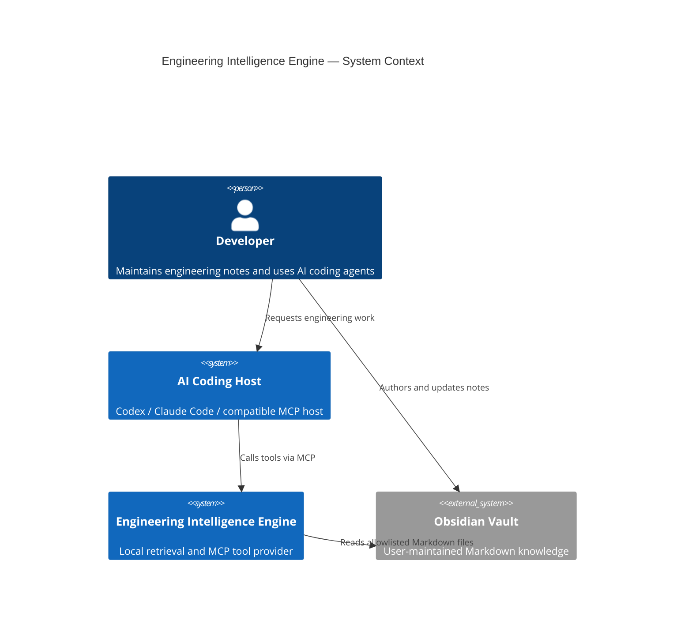
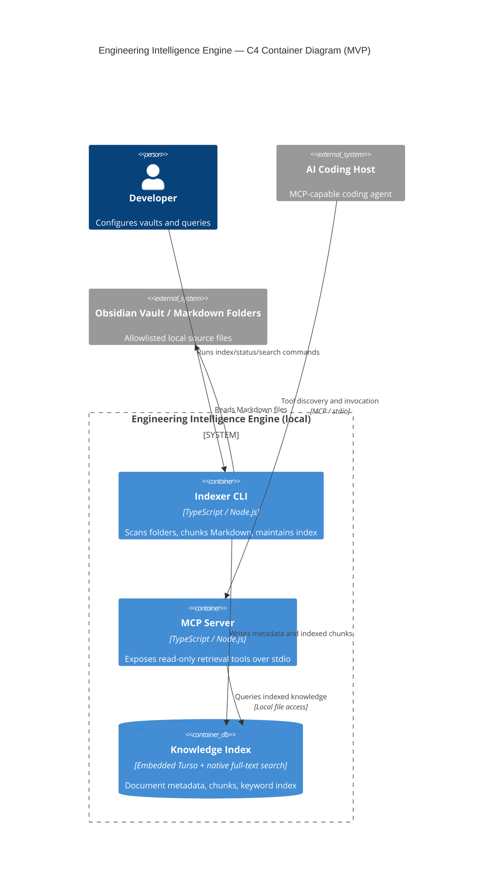
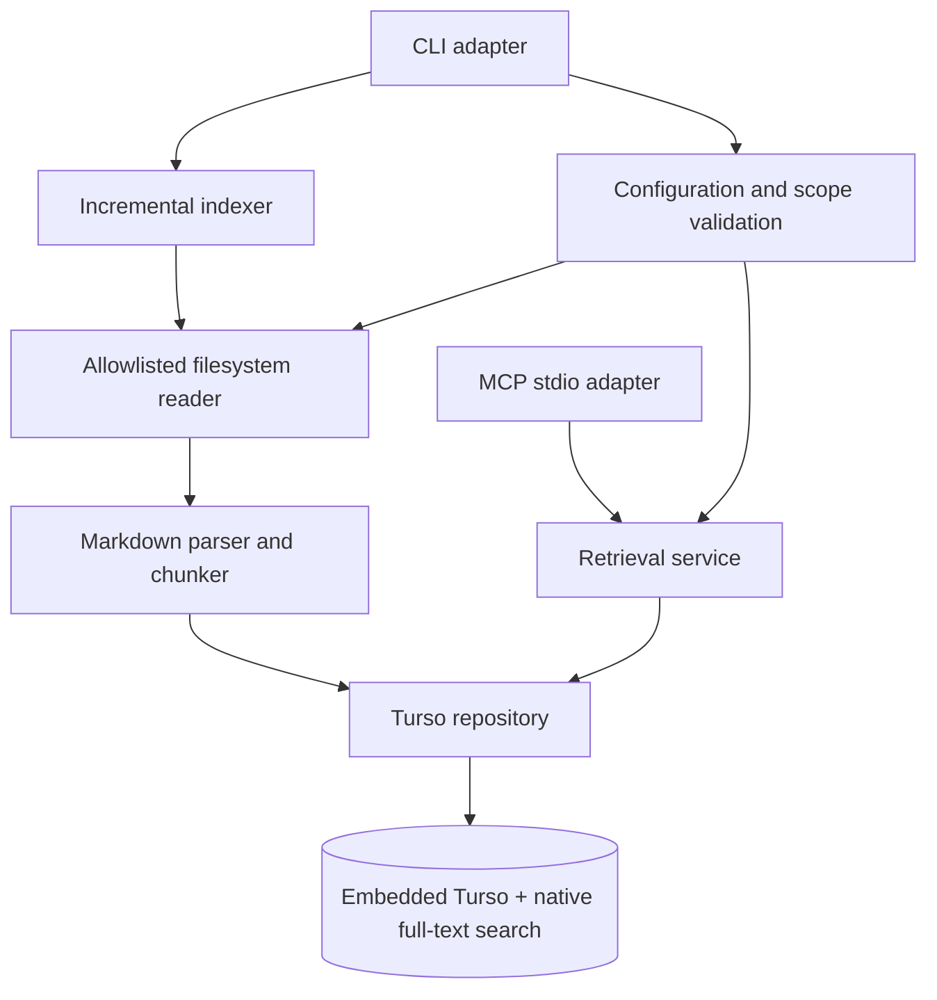
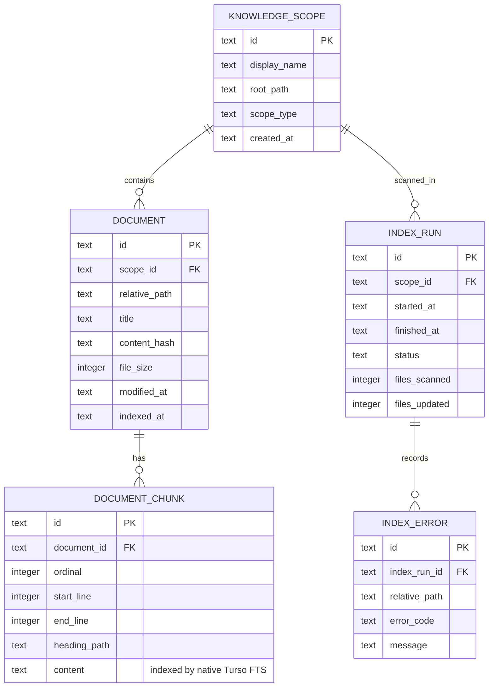
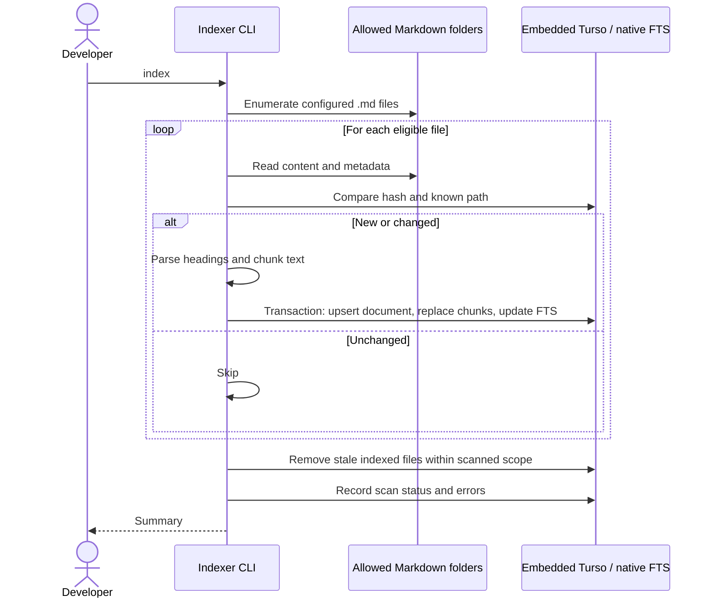
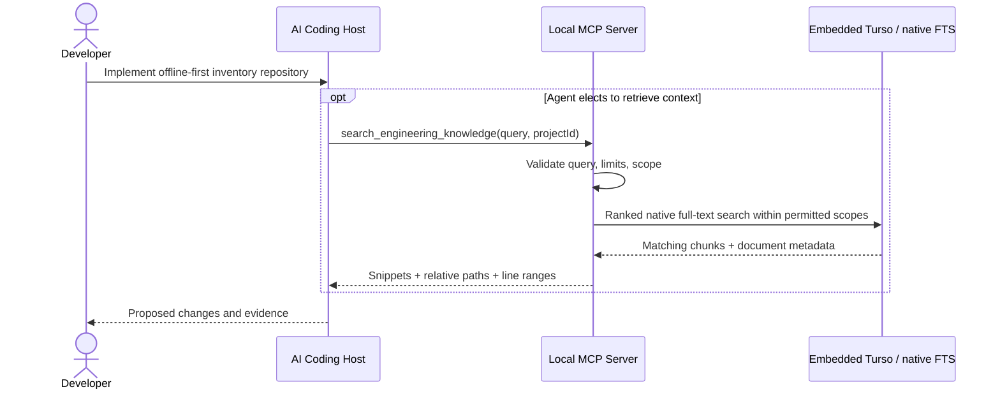

# Engineering Intelligence Engine — MVP Technical Specification

**Status:** Approved embedded Turso direction, subject to compatibility milestone  
**Audience:** Codex / engineering contributors  
**Version:** 0.2  
**Target:** Local Windows development environment; cross-platform Node.js where practical  
**Primary language:** TypeScript  
**Delivery:** Local Model Context Protocol (MCP) server; no web UI or cloud deployment required

> **Instructions for Codex:** Treat this document as the project specification. First inspect the repository and environment. If the repository is empty, scaffold the MVP. Work in small, testable increments. Do not implement deferred features unless requested. Do not modify an Obsidian vault or project repository. Ask for missing paths rather than inventing them. After each milestone, report files changed, commands executed, test results, and unresolved decisions.

## 1. Problem statement

AI coding agents frequently lack access to approved engineering decisions, reusable standards, and project-specific documentation. Repeatedly pasting this context is inefficient and can cause inconsistent implementations.

Build a **local-first Engineering Intelligence Engine** that indexes user-approved Markdown knowledge (initially from an Obsidian vault) and exposes evidence-backed retrieval through MCP. The engine is a knowledge-access service, **not** an autonomous coding agent. Its output should include citations to source files and should not claim to verify correctness of generated code.

## 2. Goals and boundaries

### Goals

1. Read Markdown files from explicitly configured local directories, including selected Obsidian vault folders.
2. Store passages and metadata in a local Turso Database file and rank keyword matches using its native full-text index.
3. Expose an MCP tool for searching and retrieving relevant passages with file references.
4. Support separate knowledge scopes for different projects and shared engineering practices.
5. Keep source Markdown authoritative; the index is rebuildable.
6. Make indexing and retrieval testable without an AI model, network connection, or GUI.
7. Allow later addition of Graphify and semantic/vector retrieval without changing the core retrieval contract unnecessarily.

### Non-goals for MVP

- Building a desktop or browser UI.
- Deploying a publicly accessible service.
- Writing back to Obsidian notes or source repositories.
- Automatically modifying source code.
- Running Graphify, embeddings, pgvector, a local LLM, or vector similarity search.
- Crawling arbitrary directories, websites, private accounts, or network shares.
- Guaranteeing that an agent invokes an MCP tool or follows retrieved guidance.
- Replacing code review, tests, or security verification.

## 3. Stakeholders and actors

- **Developer/operator:** Configures approved folders, indexes notes, runs tests, and reviews search results.
- **MCP host / coding agent:** Discovers tools and requests knowledge relevant to a development task.
- **Obsidian vault:** Existing directory of Markdown notes; read-only source.
- **Local filesystem:** Contains source notes, project documentation, and the engine's private Turso index.

## 4. Architectural decisions

| ID | Decision | Rationale |
|---|---|---|
| ADR-001 | TypeScript on supported Node.js LTS | Consistent with developer stack and MCP SDK ecosystem |
| ADR-002 | MCP server using `stdio` transport | Local integration; no listening HTTP port required |
| ADR-003 | Embedded Turso + native full-text search for MVP | Minimal operational dependencies; supports keyword retrieval |
| ADR-004 | Markdown files are source of truth | Portable, human-editable, and rebuildable index |
| ADR-005 | Explicit allowlisted roots | Prevents accidental indexing of unrelated/private data |
| ADR-006 | Read-only source access | Limits risk to notes and repositories |
| ADR-007 | CLI indexing initially | Avoids file-watcher race conditions and unnecessary background services |
| ADR-008 | Project-aware retrieval with shared scope | Prevents project-specific guidance leaking across projects |
| ADR-009 | No vector search in MVP | Validate baseline retrieval quality before adding complexity |
| ADR-010 | Reusable retrieval service behind MCP adapter | Makes future CLI, REST, Graphify, and vector integrations possible |

**Dependency policy:** Use maintained versions of the official MCP TypeScript SDK, the local-only `@tursodatabase/database` TypeScript driver (compatibility baseline 0.8.4), and a Markdown parser only if needed. Pin dependencies with a lockfile. Avoid unnecessary frameworks, ORMs, queues, Docker, or web servers for MVP.

### Embedded driver and compatibility

Use the official local-file driver. Reject remote URLs and network-share paths. Runtime configuration contains a local database path only. Dependencies may be downloaded during setup. Indexing and MCP retrieval must work offline after setup. The Turso engine is SQLite-compatible but implements its own keyword index. Its native exact vector functions are a future evaluation option. The MVP schema has no embeddings.

The Windows compatibility milestone verifies scoped ranking and cross-process access before application scaffolding. Record the exact SDK version, query shape, feature flags, and limitations. A failed gate requires review before implementation proceeds.

Sources: [official TypeScript reference](https://docs.turso.tech/sdk/ts/reference), [Turso full-text index](https://turso.tech/blog/beyond-fts5), [engine feature status](https://github.com/tursodatabase/turso).

## 5. Functional requirements

| ID | Priority | Requirement | Acceptance criteria |
|---|---|---|---|
| FR-01 | Must | Load and validate local configuration | Invalid/missing configuration produces actionable errors; no implicit scan of home drive |
| FR-02 | Must | Define one or more named knowledge scopes | At least `shared` and a named project scope supported |
| FR-03 | Must | Scan configured folders recursively for `.md` files | Only files within allowed roots are indexed; excluded paths skipped |
| FR-04 | Must | Parse Markdown into retrievable passages | Headings and file-relative locations preserved; empty files handled |
| FR-05 | Must | Persist file metadata, content chunks, and search index | Index survives process restart |
| FR-06 | Must | Incrementally reindex changed files | Unchanged files skipped; modified files updated; deleted files removed on rescan |
| FR-07 | Must | Search knowledge using Turso native full-text search | Returns ranked results with snippets, title, scope, path, and line ranges when available |
| FR-08 | Must | Filter retrieval by project scope | A project query searches that project plus shared scope; unrelated project results excluded by default |
| FR-09 | Must | Expose MCP tool `search_engineering_knowledge` | Compatible MCP client can list and invoke tool with validated arguments |
| FR-10 | Must | Expose MCP tool `get_document` | Returns bounded content from a specific indexed document, after scope validation |
| FR-11 | Must | Provide CLI commands `index`, `search`, and `status` | Commands work without MCP host; machine-readable JSON output option for search |
| FR-12 | Must | Return explicit no-match and error results | No fabricated source text or silent failures |
| FR-13 | Must | Index Markdown without changing it | Hashes and modification times of source files unchanged after indexing |
| FR-14 | Should | Ignore common sensitive/unwanted paths | Configurable exclusions; sensible defaults such as `.git`, `.obsidian`, `node_modules`, `.env*` |
| FR-15 | Should | Normalize Obsidian frontmatter and headings | Title/tags available as metadata; wikilinks remain readable; no graph inference required |
| FR-16 | Should | Provide `rebuild` command | Deletes and reconstructs index only after explicit command; does not delete source notes |
| FR-17 | Should | Expose index health information | Number of files/chunks, last successful scan, and errors visible in `status` |
| FR-18 | Could | Inspect query relevance via test fixtures | Automated regression tests for known queries and expected results |

### MCP tool contracts

**Tool: `search_engineering_knowledge`**

Input:

```json
{
  "query": "offline-first inventory repository",
  "projectId": "groceryos",
  "limit": 5
}
```

- `query`: required non-empty string, bounded length.
- `projectId`: optional configured project identifier; when supplied, search its scope plus `shared`.
- `limit`: optional integer, default 5, maximum 20.
- When no project is specified, search `shared` only by default; an explicit configuration may designate a different safe default.

Illustrative output payload (inside MCP tool result content):

```json
{
  "results": [
    {
      "documentId": "stable-document-id",
      "scope": "groceryos",
      "title": "Offline-first architecture",
      "relativePath": "architecture/offline-first.md",
      "startLine": 12,
      "endLine": 28,
      "snippet": "Local SQLite is used for immediate CRUD operations...",
      "score": 0.82
    }
  ]
}
```

`score` is an implementation-defined retrieval score, **not** a calibrated probability or confidence estimate. The example above is illustrative and not a real indexed document.

**Tool: `get_document`**

Input:

```json
{
  "documentId": "stable-document-id",
  "projectId": "groceryos",
  "startLine": 1,
  "maxLines": 100
}
```

Return the requested bounded text, document metadata, and a source citation. Enforce scope checks and output size limits. Never accept arbitrary absolute paths from the agent as a substitute for `documentId`.

### CLI behavior

```bash
pnpm dev -- index
pnpm dev -- search "offline-first inventory" --project groceryos
pnpm dev -- status
pnpm dev -- rebuild
```

These are **target commands**, not claims that a repository already implements them. Codex may select a more idiomatic CLI entry point but must document the final commands and provide equivalent behavior.

## 6. Non-functional requirements

| ID | Category | Requirement / verification |
|---|---|---|
| NFR-01 | Privacy | All MVP indexing and search remain local; no telemetry or external API calls |
| NFR-02 | Security | Resolve and canonicalize paths; reject paths escaping configured roots, including symlink escapes |
| NFR-03 | Data integrity | Index updates are transactional; interrupted indexing must not leave partially updated documents |
| NFR-04 | Reliability | Missing/unreadable files are reported without aborting all other files; malformed Markdown treated as text safely |
| NFR-05 | Performance | On a representative fixture of 1,000 Markdown files / 10,000 chunks, warm keyword search should target p95 under 300 ms on developer hardware; measure and report rather than assume |
| NFR-06 | Resource use | Avoid loading the entire vault into memory; use bounded chunking and batched writes |
| NFR-07 | Portability | Support Windows paths correctly; avoid shell-dependent runtime logic; test on Windows and ideally Linux |
| NFR-08 | Maintainability | Separate filesystem, parsing, indexing, retrieval, and MCP transport layers |
| NFR-09 | Testability | Unit tests for chunking/scopes/path security; integration tests with temporary embedded Turso database and fixture vault |
| NFR-10 | Observability | Structured errors and diagnostic logs to stderr; reserve stdout for MCP protocol messages |
| NFR-11 | Reproducibility | Lockfile, pinned toolchain expectations, documented setup and deterministic fixture tests |
| NFR-12 | Input safety | Treat retrieved Markdown as untrusted data, not executable instructions; do not execute embedded code or commands |
| NFR-13 | Output bounds | Limit result count, document length, and response size to avoid context flooding |
| NFR-14 | Offline operation | After dependencies are installed, normal indexing/search requires no internet |
| NFR-15 | Recovery | Index can be deleted and rebuilt from source notes; documented backup not required for derived data |

## 7. C4 architecture

### 7.1 System context (C4 Level 1)



### 7.2 Container diagram (C4 Level 2)

> In C4 terminology, a *container* is a separately executable application or data store, **not necessarily a Docker container**. All engine components run locally.



The CLI and MCP server are **two entry points to shared TypeScript library modules**. They do not require separate deployable services or containers.

### 7.3 Component view (within the Node.js application)



## 8. Data model and ERD

Although the product has no end-user web application, **it still benefits from a relational data model** because it persists searchable metadata and chunks.



**Schema requirements:**

- `KNOWLEDGE_SCOPE.id` is a stable configured identifier such as `shared` or `groceryos`.
- Unique `(scope_id, relative_path)` on `DOCUMENT`.
- Unique `(document_id, ordinal)` on `DOCUMENT_CHUNK`.
- Foreign keys enabled; deleting a document cascades to its chunks.
- Define a native full-text index on document chunk content with Turso's `CREATE INDEX ... USING fts` index method. Verify transactional visibility after edits, rollback and cascade deletion. The physical search index is derived from chunks and adds no independent business entity.
- Store timestamps in an unambiguous ISO-8601 UTC representation.
- Document IDs must be stable for unchanged paths within a scope; chunk IDs may change on re-chunking.
- A configured root path is local machine configuration and must not be sent to an AI host unless explicitly needed. Search results should prefer relative paths.
- No user accounts, authentication tables, or multi-tenant authorization model in MVP. Local filesystem permissions and scope restrictions form the initial trust boundary.

## 9. Indexing and retrieval flows

### 9.1 Index/update sequence



**Deletion safety:** Only remove stale documents when the relevant scope's enumeration completed successfully. A failed or inaccessible directory must not be mistaken for an empty vault.

### 9.2 Retrieval sequence



**Important:** The AI host decides whether to call the tool; tool availability alone does not guarantee invocation. Host-specific instructions can encourage retrieval but must not be assumed to enforce it.

## 10. Retrieval behavior

1. Normalize and validate user query; do not build SQL by string concatenation.
2. Search allowed scopes only, defaulting to `shared` unless a configured project is specified.
3. Use the verified Turso native ranking query and document its scoring and deterministic tie handling. Verify eligible top-k before returning results. Handle punctuation and malformed FTS queries safely.
4. Deduplicate overlapping chunks from the same document where appropriate.
5. Return a bounded number of passages, with file path and line metadata.
6. Preserve the difference between **retrieved source text** and **instructions for the agent**.
7. Never synthesize missing passages or present an absent document as indexed.

**Chunking baseline:** Prefer heading-aware Markdown sections, splitting oversized sections into bounded overlapping chunks. Initial configurable target: approximately 1,000–2,000 characters per chunk with modest overlap. Preserve line offsets and test that citations map to actual source lines. Do not split code fences carelessly; if unavoidable, preserve their meaning as plain text.

## 11. Configuration

Use a user-local configuration file (for example, `config.local.json`) excluded from Git. Commit a `config.example.json` with placeholders only.

```json
{
  "databasePath": "./data/engineering-intelligence.db",
  "scopes": [
    {
      "id": "shared",
      "displayName": "Shared Engineering Knowledge",
      "rootPath": "E:/Obsidian/Engineering",
      "type": "shared"
    },
    {
      "id": "groceryos",
      "displayName": "GroceryOS",
      "rootPath": "E:/Obsidian/Projects/GroceryOS",
      "type": "project"
    }
  ],
  "exclude": ["**/.git/**", "**/.obsidian/**", "**/node_modules/**", "**/.env*"],
  "search": { "defaultLimit": 5, "maxLimit": 20 }
}
```

Paths are **examples**, not verified paths on the developer's computer. Support environment-variable override for configuration location. Resolve and validate all roots before scanning. Do not commit actual vault contents or index files.

## 12. Security and trust model

- **Threats:** Accidental disclosure of private notes, path traversal, symlink escape, malicious Markdown prompt injection, unbounded tool output, malformed search input, Turso index corruption, and accidental source modification.
- **Trust boundaries:** MCP host arguments are untrusted; vault content is untrusted data; configured filesystem roots are operator-approved; the Turso index is derived local state.
- **Controls:** Allowlisted roots, canonical path containment checks, parameterized SQL, read-only source access, output size caps, explicit project scopes, atomic transactions, safe logging, and no network listener.
- **Prompt injection:** A Markdown note saying “ignore previous instructions” is still document content. The engine should label source material and never promote retrieved text into higher-priority instructions.
- **MCP access:** A local MCP host that can invoke the tool may read indexed notes within its configured scope. Do not expose sensitive folders to an untrusted host. If remote transport is added later, authentication and authorization require a new design review.

## 13. Repository structure (proposed)

```text
engineering-intelligence/
├── src/
│   ├── cli.ts
│   ├── config/
│   │   └── load-config.ts
│   ├── filesystem/
│   │   └── allowed-markdown-reader.ts
│   ├── markdown/
│   │   └── chunk-markdown.ts
│   ├── indexing/
│   │   └── index-service.ts
│   ├── retrieval/
│   │   └── search-service.ts
│   ├── storage/
│   │   ├── turso.ts
│   │   └── migrations/
│   └── mcp/
│       └── server.ts
├── tests/
│   ├── fixtures/
│   ├── unit/
│   └── integration/
├── config.example.json
├── .gitignore
├── package.json
├── tsconfig.json
└── README.md
```

Keep the architecture modular without adding abstractions that have only one trivial implementation.

## 14. Delivery milestones

### First milestone — Embedded Turso compatibility

- Verify keyword ranking within project plus shared scope, shared-only default, top-k and citations using synthetic fixtures.
- Verify Windows CLI-writer and read-only MCP-reader coexistence in separate processes, including committed visibility and transaction isolation.
- Stop for review on a failed gate. Proceed to Milestone 0 after approval of the findings.

**Windows compatibility findings.** Tested the published `@tursodatabase/database@0.8.4` Windows x64 binding with Node.js 26.12.1, local files and synthetic records. Open the database with `experimental: ['index_method']` for native FTS. The SDK rejected SQLite's `USING fts5`. Reuse the same bound query parameter (`?1`) for `fts_match` and `fts_score`. In the tested direct join to document metadata, matches survived but scores became zero. Materializing ranked chunk IDs and scores before joining metadata preserved the scores. Apply scope filtering before the result limit and use a stable tie-breaker.

On a synthetic fixture of 1,000 documents and 10,000 chunks, the following query returned eligible results even when another project's chunks ranked higher. Shared-only lookup, project-plus-shared lookup, citation line mapping and empty results passed. Over 100 warm database queries for one term, p95 was 5.34 ms on the test machine. This measures SQL retrieval only. Recheck with the final schema, varied queries, connection strategy and MCP adapter.

```sql
WITH ranked AS MATERIALIZED (
    SELECT id, fts_score(content, ?1) AS score
    FROM chunks
    WHERE fts_match(content, ?1)
    ORDER BY score DESC
)
SELECT c.id, d.scope, d.path, c.startLine, c.endLine, c.content, r.score
FROM ranked AS r
CROSS JOIN chunks AS c ON c.id = r.id
CROSS JOIN docs AS d ON d.id = c.doc
WHERE d.scope IN (?2, 'shared')
ORDER BY r.score DESC, c.id
LIMIT ?3;
```

These are fixture column names. Bind the validated query, permitted project ID (or `shared`), and capped limit. The explicit join order produced primary-key lookups for chunk and document metadata. Use the retrieval layer to bound the returned snippet.

**Unguarded baseline.** With the default file backend, a newly opened read-only process excluded an uncommitted insertion and saw it after commit. A read-only connection opened before a separate writer committed continued returning the old result after that writer closed. Closing and reopening the reader exposed the committed passage. Opening with `multiprocess_wal` failed on the active Windows I/O backend. A long-lived MCP reader cannot rely on automatic refresh with this configuration.

**Windows concurrency check passed.** Four independent runs on Windows x64 (Node 26.12.1, Turso 0.8.4) used separate Node processes and disposable native-FTS databases. All processes opened the same persistent sibling guard file, acquired an exclusive OS lock before opening Turso, and closed Turso before releasing the guard. The probe used [fs-native-extensions](https://github.com/holepunchto/fs-native-extensions) 1.5.4. A long-running reader process that reopened its read-only database connection for each operation saw the latest committed passage. With a 250 ms acquisition budget and 10 ms polling, competing readers and writers returned busy in 252 to 270 ms. Forced termination of a reader released the guard. Forced termination of a writer before commit left its passage absent, and termination after commit preserved the searchable passage.

**Implementation decision for Windows.** All cooperating entry points must use the same guard for a canonical index path, including rebuild, migrations and reads. Keep the guard file in place across rebuilds. The OS owns the lock lifetime. Acquire it with a bounded wait and report a retryable busy error on timeout. Release it after closing the database. This serializes local index operations, including concurrent reads, and adds one native locking dependency. Test other platforms separately. The previous SQL latency measurement excludes lock contention and connection setup.

### Milestone 0 — Scaffold and contract tests

- Initialize TypeScript project and scripts for build, typecheck, lint, and tests.
- Add validated configuration loader and example configuration.
- Add temporary fixture vault and test harness.
- **Exit:** `pnpm install`, `pnpm build`, `pnpm test`, and `pnpm typecheck` pass (or equivalent documented commands).

### Milestone 1 — Index Markdown into embedded Turso

- Implement safe folder enumeration, parser/chunker, schema/migrations, and transactional indexer.
- Implement `index`, `status`, and `rebuild` CLI.
- **Exit:** Create/change/delete scenarios pass; source files remain untouched; failed scan does not delete valid indexed documents.

### Milestone 2 — Local keyword retrieval

- Implement Turso native full-text search, project scope filtering, snippets, and line citations.
- Implement `search` CLI.
- **Exit:** Fixture queries return expected documents; wrong-project documents do not appear; invalid input handled safely.

### Milestone 3 — MCP adapter

- Implement MCP `stdio` server using the official TypeScript SDK.
- Expose `search_engineering_knowledge` and `get_document`.
- **Exit:** A compatible MCP test client can list tools, invoke both, and receive valid results; stdout contains only protocol output.

### Milestone 4 — Agent integration and documentation

- Document exact launch command and example configuration for one **verified** MCP host (Codex or Claude Code first).
- Validate a real task against fixture or approved vault notes.
- **Exit:** End-to-end demonstration: host retrieves a specific note and cites its source; limitations documented.

### Milestone 5 — Automatic index refresh (post-MVP)

Approved by the operator on 2026-11-23 as the first post-MVP milestone. It implements future extension 5 (incremental watcher). Automatic project detection remains a separate, later item.

- Add a `watch` CLI command that keeps the index current while it runs. Use recursive filesystem watching per configured root. Ignore excluded paths and files other than Markdown. Treat events without an extension as possible directory changes.
- Debounce changes per scope, with a quiet period and a maximum wait. Rescan only the affected scopes through the existing transactional scope scan. Hash skipping, deletion only after a complete enumeration and preservation of an unavailable root's entries must behave as they do for `index`.
- Hold the index guard only during a rescan, so MCP reads and other commands can interleave. Retry a busy index after a delay. Do not retry other failures on a timer.
- Recover without a restart. A missing root is reattached when it appears. A root found unavailable is reattached by path. A periodic reconciliation (default 15 minutes, configurable, can be disabled) renews watchers and rescans every scope to cover missed events.
- Print one JSON object per line to stdout. Stop cleanly on SIGINT or SIGTERM.
- Do not change the MCP tool contracts, the schema or the configuration file.
- **Exit:** Fixture tests cover create, edit and delete in nested folders; ignored excluded and non-Markdown files; one rescan per burst of edits; retry after a busy index; a root that appears later; a root that is moved away and replaced; reconciliation; and the CLI's JSON output. The existing suite still passes. A run against an approved real scope is recorded.

### Milestone 6 — Retrieval evaluation (post-MVP)

Started on 2026-11-24 as the next post-MVP milestone. It implements the evaluation corpus and metrics from future extension 6 and produces the evidence that extension 2 (hybrid retrieval) requires.

- Define an operator-local evaluation file (`evaluation.local.json`, ignored by Git, with a committed placeholder example). Each case has a unique ID, a query, an optional project, tags, and one or more expected documents. An expected document has a scope, a relative path and optional inclusive lines that a cited passage must overlap. Reject cases whose expected scope the search cannot reach.
- Add an `eval` CLI command. It runs each case through `searchKnowledge` at the configured maximum limit and reports hit@1, hit@3, hit@5, hit@depth, MRR, recall@5 and latency percentiles, overall and per tag and per project, along with each case's rank and top results. A search error counts as a miss.
- Support saving a report and comparing a run with a saved baseline. Report metric deltas, added and removed cases, improvements and regressions (a case that falls out of the top 5). Exit with code 1 on any regression.
- Show the same report and comparison in the local viewer.
- Do not change the MCP tool contracts, the schema or the index.
- **Exit:** Fixture tests cover exact metrics, line constraints, grouping, baseline regressions and case changes, invalid and unreachable cases, and the viewer endpoint. A baseline for an approved real scope is recorded, separating keyword queries from paraphrased ones.

**Stop after each milestone for review if running in an interactive Codex session.** Do not implement the whole roadmap in one unreviewed pass.

## 15. Test plan and acceptance matrix

| Test | Expected outcome |
|---|---|
| Index two Markdown files | Both discoverable by CLI search |
| Edit one file | Changed chunks replace old ones; unchanged file skipped |
| Delete one file, rescan successful scope | Deleted file no longer searchable |
| Simulate inaccessible scope | Existing indexed documents are not mass-deleted |
| Place note outside allowlisted root | Never indexed or retrievable |
| Add symlink pointing outside root | Target rejected |
| Query project A | Returns project A and shared; excludes project B |
| Search malformed FTS syntax | Safe validation/error or escaped fallback; no crash |
| Put prompt-injection text in note | Returned as attributed data, not executed |
| Request arbitrary absolute path via MCP | Rejected; `get_document` accepts indexed IDs only |
| Run MCP server | Tool discovery and invocation succeed with valid protocol output |
| Index same vault twice | No duplicate documents/chunks; unchanged content remains stable |
| Delete the derived Turso index and rebuild | Equivalent searchable content reconstructed from Markdown |
| Run offline | Indexing and keyword search work without network |

## 16. Operational instructions

1. Install a supported Node.js LTS release and pnpm.
2. Clone the project and install locked dependencies.
3. Copy `config.example.json` to `config.local.json`; replace sample paths with approved real folders.
4. Run migrations/indexing through the documented CLI.
5. Test local search before connecting any AI host.
6. Register the built MCP server as a local `stdio` command in a supported host.
7. Re-run `index` when notes change, or keep `watch` running (Milestone 5) to refresh the index automatically.

**No deployment requirement:** The host starts the MCP server as a local child process. No domain, VPS, Docker, reverse proxy, or cloud database is needed. A packaged npm CLI may be considered after the MVP is stable.

### Existing SQLite index migration

For an existing installation, create a separate Turso index file. Reindex approved Markdown and compare document counts, stable IDs, representative results and citations. Switch the local configuration after verification. Retain the old database for rollback and historical scan logs. A rebuild reconstructs the notes and chunks only. The initial empty project needs only the first versioned schema migration.

## 17. Future extensions — explicitly out of scope

1. **Graphify adapter:** Retrieve symbol dependencies and code impact information from an installed Graphify instance, after verifying its actual APIs and version. Do not assume its MCP tool names or schemas.
2. **Hybrid retrieval:** Add embeddings and vector search only after collecting retrieval quality failures that keyword search cannot solve. Evaluate exact cosine similarity in the embedded engine against scoped retrieval quality and latency. Verify any approximate index on the selected driver before relying on it.
3. **Skills-aware retrieval:** Index selected `SKILL.md` metadata and provide explicit skill selection. Skills are operational instructions and must be reviewed before being elevated to agent guidance.
4. **Automatic project detection:** Safely map a verified repository path to a configured project scope, with manual override.
5. **Incremental watcher:** Debounced file watching with recovery and periodic reconciliation. Delivered as Milestone 5.
6. **Retrieval diagnostics:** Local dashboard, query evaluation corpus, and retrieval metrics. The corpus, metrics and viewer report were delivered as Milestone 6.
7. **Packaging:** npm-distributed executable with documented updates and cross-platform installation.
8. **Remote MCP transport:** Only if there is a concrete need; requires separate authentication, authorization, and threat modeling.

## 18. Open questions / assumptions

- **Actual Obsidian vault location:** Unknown; operator must provide it.
- **First MCP host:** Recommend Codex or Claude Code for initial verification; T3 Code integration requires checking current support.
- **Selected knowledge folders:** Must be explicitly approved before indexing.
- **Initial project scope:** `groceryos` is illustrative; no actual notes are assumed to exist.
- **Index refresh:** Manual CLI in MVP. Milestone 5 adds the optional `watch` command. Starting it at logon is left to the operator.
- **Embedding model:** Not selected because vector retrieval is deferred.

## 19. Definition of done (MVP)

The MVP is complete when a developer can configure an approved local Markdown folder, index it into embedded Turso, search it via CLI, and retrieve cited passages through a functioning local MCP server from at least one compatible AI host. The implementation must pass the acceptance tests, preserve source files, enforce scope/path restrictions, and operate without cloud deployment or network calls during normal use.

## 20. Implementation entry point

Complete and review the embedded Turso compatibility milestone before scaffolding Milestone 0. Use temporary synthetic fixtures until an operator approves actual knowledge folders. Continue one reviewed milestone at a time.
